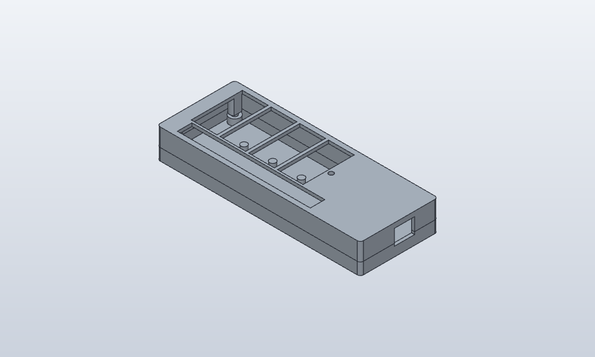

# Case for the carrier board

A two-part printed case for the carrier board in `../pcb`, made to stick to the back of a DRO
with adhesive tape. Outside 131 x 50 x 19.1 mm.

| File | What |
|---|---|
| `case-base.stl` | Base: flat back for the tape, standoffs under the board |
| `case-lid.stl` | Lid: openings for the four scale plugs, the DRO ribbons and USB |
| `rp2040-encoder-carrier-case.step` | Both parts as STEP |
| `rp2040-encoder-carrier-case.sc` | SolidCraft source |

## Layout

- The board sits on five standoffs 4 mm above a 2 mm floor; six pillars under the scale sockets
  take the force of plugging in.
- Four openings of 16.6 x 33 mm let the scale plugs' hoods (16 x 32 mm) through the lid down to
  the sockets. One slot takes the four DRO ribbon plugs. USB leaves through the end wall.
- A 3 mm hole in the lid sits over the 5 V LED.
- Inside height above the board is 9.5 mm, enough for an RP2040-Zero on pin headers.

## Printing and assembly

- Print the base as it lies and the lid upside down; neither needs supports. Walls are 2 mm.
- Five M3 x 12 button-head screws go in from the back, through base and board, into 2.5 mm
  pilot holes in the lid's posts. Their heads sit recessed in the floor, so fit them before the
  tape goes on.

Not yet printed or fitted.
