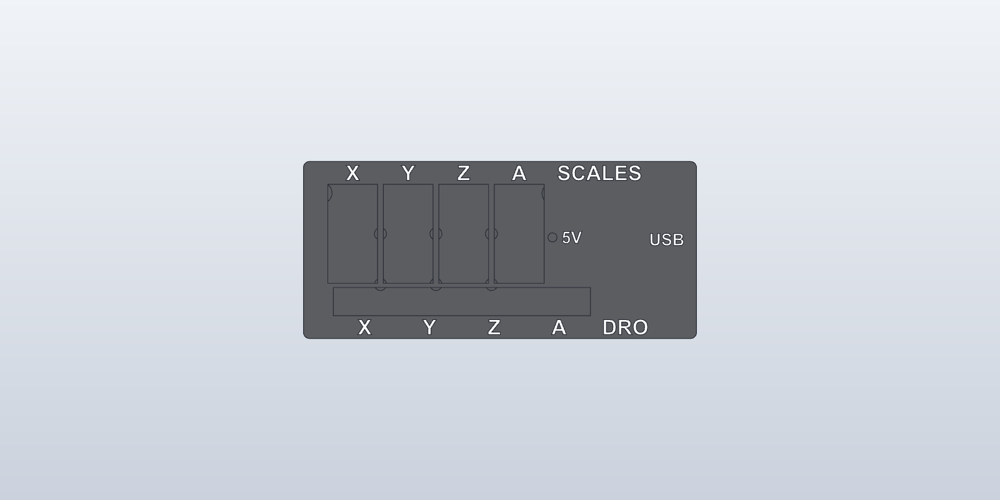

# Case for the carrier board

A two-part printed case for the carrier board in `../pcb`, made to stick to the back of a DRO
with adhesive tape. Outside 131 x 59 x 19.1 mm.

| File | What |
|---|---|
| `case-base.stl` | Base: flat back for the tape, standoffs under the board |
| `case-lid.stl` | Lid: openings for the four scale plugs, the DRO ribbons and USB, with the labels recessed |
| `case-labels.stl` | The labels alone, in place in the lid, for a second colour |
| `case-lid-with-labels.3mf` | Lid and labels together as two parts, for a multi-colour slicer |
| `rp2040-encoder-carrier-case.step` | All parts as STEP |
| `rp2040-encoder-carrier-case.sc` | SolidCraft source |

## Layout

- The board sits on five standoffs 4 mm above a 2 mm floor; six pillars under the scale sockets
  take the force of plugging in.
- Four openings of 16.6 x 33 mm let the scale plugs' hoods (16 x 32 mm) through the lid down to
  the sockets. One slot takes the four DRO ribbon plugs. USB leaves through the end wall.
- A 3 mm hole in the lid sits over the 5 V LED.
- Inside height above the board is 9.5 mm, enough for an RP2040-Zero on pin headers.
- Base and lid meet in a lip-and-groove joint. The base carries a lip 0.9 mm wide and 1.5 mm
  high on the inner half of its wall; the lid has a matching step 1.05 mm wide and 1.7 mm deep,
  so there is 0.15 mm of play sideways and the outer faces meet before the lip bottoms out. The
  lip is interrupted at the USB cut-out.
- The case is 4.5 mm wider than the board needs on each long side. Those two bands carry the
  labels and are solid.

## Labels

The lid's face carries inlaid labels 0.6 mm deep: X, Y, Z, A and SCALES above the scale
openings, X, Y, Z, A and DRO below the ribbon slot, USB at the USB end and 5V at the LED hole.
Capitals are 5 mm high (USB and 5V: 4 mm), Arial Bold.

- Two colours: load `case-lid-with-labels.3mf`, or `case-lid.stl` and `case-labels.stl`
  together, and give the labels their own filament. The labels fill the recesses exactly.
- One colour: print `case-lid.stl` alone. The labels stay as recesses, which can be filled
  with paint.

## Printing and assembly

- Print the base as it lies and the lid upside down; neither needs supports. Printed that way
  the labels are in the first three layers at 0.2 mm, on the bed.
- Five M3 x 12 button-head screws go in from the back, through base and board, into 2.5 mm
  pilot holes in the lid's posts. Their heads sit recessed in the floor, so fit them before the
  tape goes on.

Not yet printed or fitted.
